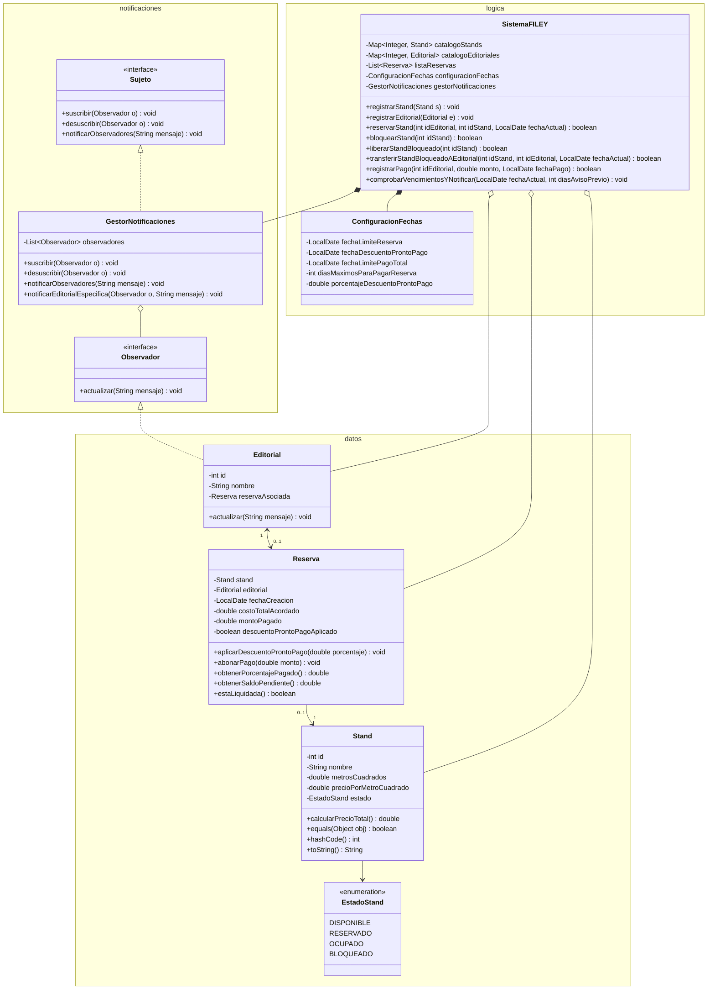

## Proyecto PD2 - Sistema Administrativo de Venta y Reserva de Stands (FILEY)

### 1. Descripción General

Sistema backend desarrollado en Java bajo el paradigma de Programación Orientada a Objetos (POO) para administrar la venta, reserva, bloqueo administrativo, procesamiento de pagos y notificaciones de vencimiento de los stands de la Feria Internacional de la Lectura Yucatán (FILEY).

### 2. Organización del Código (Paquetes)

El proyecto está estructurado en los tres paquetes solicitados:

```text
src/
├── datos/
│   ├── EstadoStand.java
│   ├── Stand.java
│   ├── Editorial.java
│   └── Reserva.java
├── logica/
│   ├── ConfiguracionFechas.java
│   └── SistemaFILEY.java
├── notificaciones/
│   ├── Observador.java
│   ├── Sujeto.java
│   └── GestorNotificaciones.java
└── MainFILEY.java
```

### 3. Requisitos Funcionales (RF)

- **RF-01 (Gestión de Stands):** El sistema debe permitir registrar y consultar stands con identificador numérico, nombre/código, dimensiones en metros cuadrados ($m^2$), precio por $m^2$ y estado (`DISPONIBLE`, `RESERVADO`, `OCUPADO`, `BLOQUEADO`).
- **RF-02 (Cálculo de Costos):** El sistema debe calcular automáticamente el costo base de un stand multiplicando sus metros cuadrados por el precio por metro cuadrado.
- **RF-03 (Gestión de Estados del Stand):** El sistema debe controlar las transiciones de estado:
  - De `DISPONIBLE` a `RESERVADO` al asignarse a una editorial.
  - De `DISPONIBLE` a `BLOQUEADO` (y viceversa) por acción administrativa.
  - De `BLOQUEADO` directamente a `RESERVADO` asignándolo a una editorial _(funcionalidad opcional)_.
  - De `RESERVADO` a `OCUPADO` únicamente cuando el monto abonado sea igual o superior al **15 %** del costo total del stand.
- **RF-04 (Gestión de Editoriales y Reservas):** El sistema debe registrar editoriales (ID, nombre) y asociarles su reserva correspondiente, llevando el control del saldo pagado y pendiente.
- **RF-05 (Configuración de Fechas y Plazos):** El administrador debe poder modificar dinámicamente la fecha límite de reserva, la fecha de descuento por pronto pago, la fecha límite de pago total y el plazo máximo (en días) para pagar una reserva.
- **RF-06 (Procesamiento de Pagos y Pronto Pago):** El sistema debe registrar abonos a una reserva, aplicando un descuento configurable si el pago se realiza antes o en la fecha de pronto pago, y actualizando el estado del stand a `OCUPADO` al alcanzar el 15 % mínimo.
- **RF-07 (Sistema de Notificaciones - Patrón Observer):** El sistema debe comprobar los vencimientos próximos (plazo de reserva, pronto pago y pago total) y notificar automáticamente a las editoriales suscritas.

### 4. Requisitos No Funcionales (RNF)

- **RNF-01 (Arquitectura Modular):** El código fuente debe estructurarse estrictamente en tres paquetes independientes (`datos`, `logica` y `notificaciones`), respetando el principio de separación de responsabilidades.
- **RNF-02 (Mantenibilidad y Extensibilidad):** La implementación de avisos debe emplear el patrón de diseño **Observer**, permitiendo agregar nuevos tipos de receptores de notificaciones sin modificar la lógica de negocio.
- **RNF-03 (Integridad y Comparación de Objetos):** Las entidades principales (`Stand`) deben sobrescribir los métodos `equals()`, `hashCode()` y `toString()` para garantizar la unicidad y correcta manipulación en colecciones de Java.
- **RNF-04 (Manejo Temporal):** El sistema debe utilizar la API moderna `java.time` (`LocalDate`, `ChronoUnit`) para el cálculo preciso de plazos y vencimientos.

### 5. Diagrama de Clases UML


